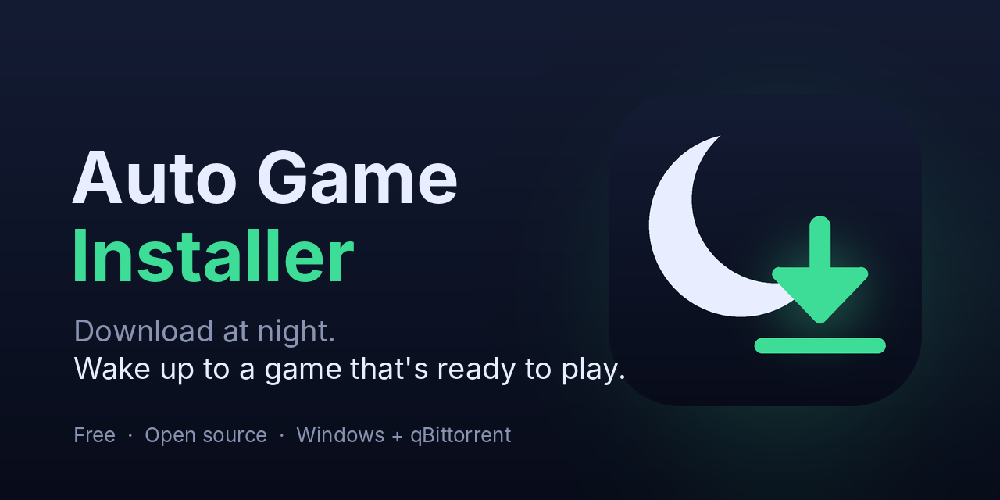

 <p align="center">
  <a href="https://github.com/Alrayyanumar56/Auto-Game-Installer/releases/tag/v0.2.0-beta">
    
  </a>
</p>

<p align="center">
  <a href="https://github.com/Alrayyanumar56/Auto-Game-Installer/releases/download/v0.2.0-beta/AutoGameInstaller.exe">
    
  </a>
</p>

<p align="center">
  <a href="https://github.com/Alrayyanumar56/Auto-Game-Installer/releases/tag/v0.2.0-beta">
    
  </a>
  <a href="https://github.com/Alrayyanumar56/Auto-Game-Installer">
    
  </a>
  <a href="https://github.com/Alrayyanumar56/Auto-Game-Installer?tab=MIT-1-ov-file">
    
  </a>
</p>


https://github.com/user-attachments/assets/0efb101e-8ada-446d-9b42-8f44382cb76d


<!-- Drag your demo video here in the GitHub editor so it embeds. -->

**Leave your PC on overnight. Wake up to a game that's already installed.**

When qBittorrent finishes a download, Auto Game Installer finds the game's `setup.exe`, installs it into the folder you chose, and logs what happened. No clicking, no waiting in the morning.

## Install (1 minute, no Python needed)

1. Download [`AutoGameInstaller.exe`](https://github.com/Alrayyanumar56/Auto-Game-Installer/releases/latest/download/AutoGameInstaller.exe).
2. Close qBittorrent completely (check the system tray).
3. Open `AutoGameInstaller.exe`, pick your games folder, choose your options, and click **Set Up**.
4. Start qBittorrent and download a game. Done.

> **Windows shows "Windows protected your PC"?** The app isn't code-signed yet, so SmartScreen warns about every new unsigned program. Click **More info → Run anyway**. The full source is in this repo, and each release includes a `.sha256` file so you can check your download.

## Features

- **Hands-free installs.** Runs the setup the moment a download finishes.
- **Install queue.** Two downloads finishing together install one after the other, never at the same time.
- **Quiet mode.** Mutes the installer's sound so it can't blast music at 3 AM. The window stays visible.
- **Shut down when done.** Optionally turns the PC off after the *last* queued install finishes (60-second warning; cancel with `shutdown /a`).
- **Full log.** See exactly what happened overnight with **Open log**.

## How it works

- Finds `setup.exe`, `install.exe` or `installer.exe` in the finished download.
- **Inno Setup installers** (most game repacks) run with `/SILENT /DIR=...`: the progress window shows, but every page is answered for you.
- **Other installers** open normally and wait for you to click through.
- qBittorrent can start as administrator so installers don't stop at a Windows permission prompt (Windows asks once each time qBittorrent opens).

Settings and the log live in `%LOCALAPPDATA%\AutoGameInstaller`.

## Troubleshooting

**Nothing installs and there's no `autoinstall.log`.** The qBittorrent hook isn't running. Re-run the app with qBittorrent fully closed, then check Options → Downloads → "Run external program on torrent finished".

**The installer opens but waits for clicks.** It isn't an Inno Setup installer, so it can't run unattended. The log says so.

**"No setup.exe found" in the log.** The download is probably an archive or disc image (`.rar`, `.iso`). Not supported yet.

**Still hearing the installer.** Muting starts a split second after the window opens, so a very short blip is possible. If it never mutes, the log says why.

**Manual setup.** Copy the command shown at the bottom of the app into qBittorrent: Options → Downloads → "Run external program on torrent finished".

## Limitations

- Windows and qBittorrent only (for now).
- `.rar` and `.iso` downloads aren't extracted yet.
- Shutdown waits for queued *installs*, not for torrents that are still downloading.
- It runs the installer in every finished torrent that contains one. It doesn't scan files. **Only use it on downloads you trust and are allowed to have.**

## Roadmap

- [ ] Extract archives and mount ISOs automatically
- [ ] Antivirus scan before running anything
- [ ] Only run for torrents in a chosen category
- [ ] Support for other torrent clients
- [ ] Code-signed release

## Run from source

```
pip install -r requirements.txt
python app.py
```

Pushing a tag like `v0.2.0` makes GitHub Actions build `AutoGameInstaller.exe` and attach it to a release. Tags with a dash (for example `v0.2.0-beta`) are marked as pre-releases.

## License

MIT
